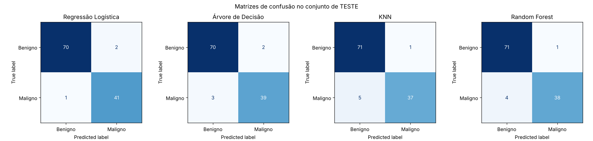
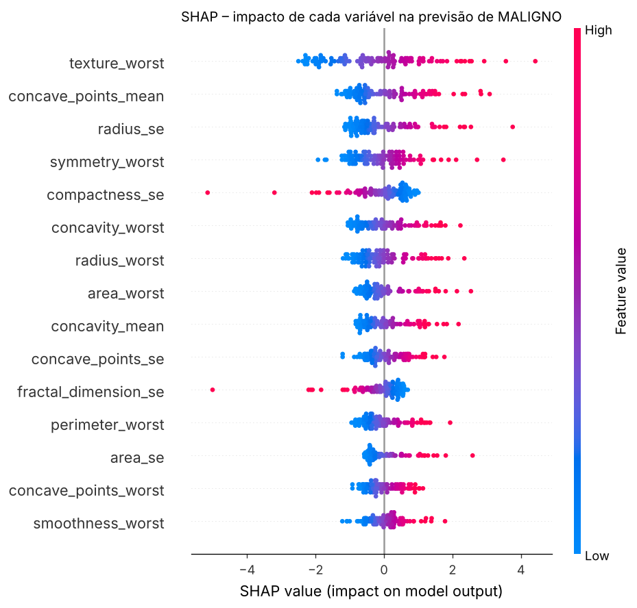

# Tech Challenge – Fase 1 (POSTECH FIAP)
## Apoio ao diagnóstico de câncer de mama com Machine Learning

Sistema inicial de IA para um hospital universitário: a partir de 30 medidas de núcleos celulares extraídas de
exames de punção aspirativa (PAAF), o modelo estima se o tumor de mama é **maligno** ou **benigno**, destacando
as variáveis que mais pesaram na decisão (SHAP). É uma ferramenta de **triagem e segunda opinião**: o médico
sempre tem a palavra final.

| | |
|---|---|
| Base | Breast Cancer Wisconsin (Diagnostic) – 569 pacientes, 30 variáveis ([Kaggle](https://www.kaggle.com/datasets/uciml/breast-cancer-wisconsin-data/data)) |
| Modelos | Regressão Logística, Árvore de Decisão, KNN, Random Forest |
| Separação | 60% treino / 20% validação / 20% teste (estratificado) |
| Métrica principal | Recall da classe maligna (não deixar câncer passar), com F1 e ROC-AUC |
| Melhor modelo | Regressão Logística: **recall 0,976 · F1 0,965 · acurácia 97,4% · AUC 0,995** no teste |

## Estrutura

```
├── main.py                       # executa todo o fluxo e salva os resultados
├── notebooks/
│   └── tech_challenge_fase1.ipynb  # notebook comentado, já executado (demonstração)
├── src/
│   ├── data.py                   # carregamento da base
│   ├── preprocessing.py          # limpeza, divisão treino/val/teste, pipeline
│   ├── eda.py                    # estatísticas e gráficos exploratórios
│   ├── modeling.py               # modelos, ajuste na validação, avaliação no teste
│   └── interpretation.py         # coeficientes, feature importance, permutation, SHAP
├── data/                         # dataset (CSV) e link para download
├── results/                      # métricas (CSV/JSON) e gráficos (figures/)
├── docs/relatorio_tecnico.md     # relatório técnico
├── Dockerfile
└── requirements.txt
```

## Como executar

### Com Docker (recomendado)

```bash
docker build -t tech-challenge-fase1 .

# roda o pipeline completo; os resultados aparecem em ./results
docker run --rm -v "$(pwd)/results:/app/results" tech-challenge-fase1
# Windows PowerShell: docker run --rm -v "${PWD}/results:/app/results" tech-challenge-fase1

# abre o notebook em http://localhost:8888
docker run --rm -p 8888:8888 tech-challenge-fase1 \
  jupyter notebook --ip=0.0.0.0 --no-browser --allow-root --IdentityProvider.token='' notebooks/
```

### Sem Docker

```bash
python -m venv .venv
# Linux/Mac: source .venv/bin/activate   |   Windows: .venv\Scripts\activate
pip install -r requirements.txt
python main.py                 # pipeline completo
jupyter notebook notebooks/    # notebook de demonstração
```

## Resultados (conjunto de teste, 114 pacientes)

| Modelo | Accuracy | Precision | Recall | F1 | ROC-AUC |
|---|---|---|---|---|---|
| **Regressão Logística** | **0,974** | 0,953 | **0,976** | **0,965** | 0,995 |
| Árvore de Decisão | 0,956 | 0,951 | 0,929 | 0,940 | 0,950 |
| KNN | 0,947 | 0,974 | 0,881 | 0,925 | 0,984 |
| Random Forest | 0,956 | 0,974 | 0,905 | 0,938 | 0,997 |




Todos os gráficos estão em [`results/figures`](results/figures) e a análise completa está no
[notebook](notebooks/tech_challenge_fase1.ipynb) e no [relatório técnico](docs/relatorio_tecnico.md).

## Dataset

O CSV em `data/` é a base Breast Cancer Wisconsin (Diagnostic). Para usar o arquivo original do Kaggle, baixe
`data.csv` em https://www.kaggle.com/datasets/uciml/breast-cancer-wisconsin-data/data e salve em `data/data.csv`.
